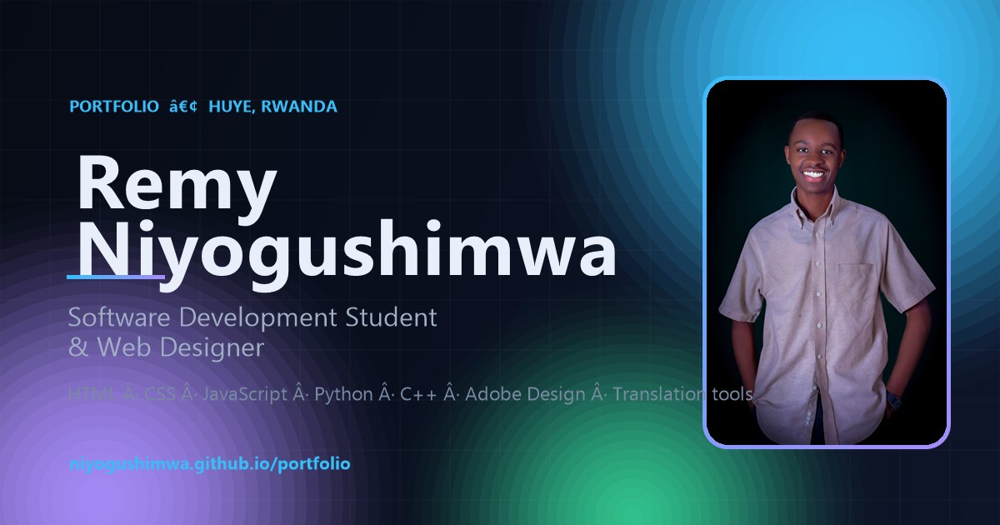

# Remy Niyogushimwa — Portfolio

A modern, responsive personal portfolio for **Remy Niyogushimwa**, a software development
student at the University of Rwanda and an A2 Software Development graduate based in
Huye, Rwanda.

**Live site:** https://niyogushimwa.github.io/portfolio/

[](https://niyogushimwa.github.io/portfolio/)
[](https://developer.mozilla.org/docs/Web/HTML)
[](https://developer.mozilla.org/docs/Web/CSS)
[](https://developer.mozilla.org/docs/Web/JavaScript)



## About

This site brings together my real background in software development, digital design and
translation technology — without invented job titles or fake experience.

- BIT student at the **University of Rwanda**
- A2 Certificate in **Software Development** (APEKI Tumba TSS, 2019–2023)
- Builds small, responsive websites with **HTML, CSS and JavaScript**
- Practices **C++ and Python**
- Works with **Adobe Photoshop, Illustrator, InDesign** and **FrameMaker**
- Uses translation tools such as **OmegaT, Lara Translate and SYSTRAN**
- Speaks **Kinyarwanda** and **English**

## Features

- Fully responsive layout (mobile, tablet, desktop)
- Dark and light themes with saved preference
- Accessible navigation, skip link, focus styles and reduced-motion support
- Scroll reveal animations and an active-section navigation indicator
- Typewriter role animation
- SEO metadata, Open Graph / Twitter cards, JSON-LD (Person, WebSite, FAQPage)
- `robots.txt`, `sitemap.xml`, web manifest and custom 404 page
- No frameworks or build step — fast, static and easy to maintain

## Tech stack

| Layer | Tools |
| --- | --- |
| Markup | Semantic HTML5 |
| Styling | Modern CSS (custom properties, grid, flexbox, clamp) |
| Behaviour | Vanilla JavaScript (ES5-safe syntax) |
| Type | Inter + Space Grotesk (Google Fonts) |
| Hosting | GitHub Pages |

## Project structure

```text
.
├── index.html                  # Main page
├── 404.html                    # Custom not-found page
├── assets/
│   ├── css/styles.css          # Design system and responsive styles
│   ├── js/main.js              # Theme, menu, scroll spy, animations
│   ├── img/                    # Portrait, favicon, social preview
│   └── files/                  # Downloadable CV
├── robots.txt
├── sitemap.xml
├── site.webmanifest
└── .nojekyll                   # Allows GitHub Pages to serve files as-is
```

## Run locally

No installation is required. Open `index.html` directly, or serve the folder:

```bash
# Option 1: Python
python -m http.server 8080

# Option 2: Node.js
npx serve .
```

Then visit <http://localhost:8080>.

## Deployment

The site is deployed with **GitHub Pages** from the `main` branch (root folder):

1. Push changes to `main`.
2. GitHub Pages rebuilds automatically.
3. Live at https://niyogushimwa.github.io/portfolio/

## Getting found

A practical checklist for Google, Bing, LinkedIn and GitHub lives in
[`docs/VISIBILITY.md`](docs/VISIBILITY.md) — including Search Console setup, LinkedIn copy,
keywords and a 30-day plan.

## Contact

- **Email:** [niyogushimwaremy@gmail.com](mailto:niyogushimwaremy@gmail.com)
- **LinkedIn:** [remy-niyogushimwa-7033a5377](https://www.linkedin.com/in/remy-niyogushimwa-7033a5377)
- **GitHub:** [@niyogushimwa](https://github.com/niyogushimwa)
- **Location:** Huye, Rwanda

---

© 2026 Remy Niyogushimwa. Built with HTML, CSS and JavaScript.
